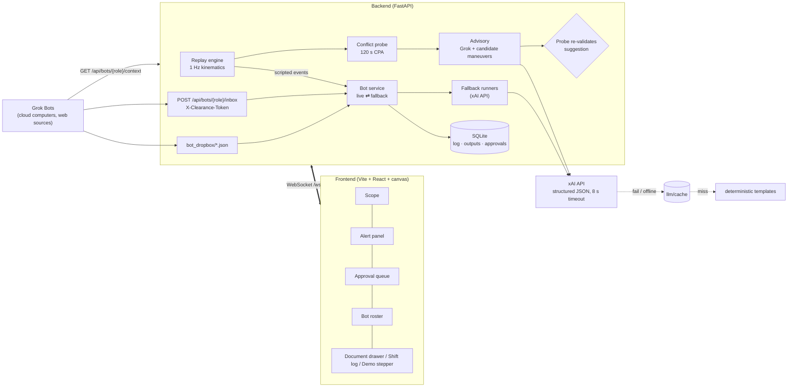

# Clearance

**A copilot for air traffic controllers: hackathon prototype.**

> ⚠️ **ADVISORY PROTOTYPE — NOT FOR OPERATIONAL USE.** Clearance runs on a replayed, scripted scenario.
> It never issues an instruction or sends a message on its own. Every suggestion and every Bot action
> waits for a human to approve it, and "sending" is simulated. Weather/NOTAM data in offline mode is a
> hand-written sample fixture, and fix names other than runways are illustrative.

Clearance has two layers:

1. **Live scope (real time, deterministic).** A radar-style display of a replayed ATL west-flow arrival
   push. A deterministic probe projects every pair 120 s ahead and flags predicted losses of separation
   (< 3 nm **and** < 1,000 ft). Grok explains each alert in plain English and picks a resolution. The
   probe re-checks that resolution and shows it only if it clears the conflict without creating a new
   one. The controller approves (the simulated pilot complies) or dismisses.
2. **Back office (slow, agentic).** Four Bot teammates handle the non-real-time workload: **Briefing**,
   **Relief**, **Coordination** and **Paperwork**. In **live** mode they are Grok Bots on their own cloud
   computers, posting finished work to the app's inbox webhook or a shared folder. In **fallback** mode the
   app runs the same four roles through the xAI API from local data. Either way, proposed actions land in an
   approval queue and do nothing until approved.

## Architecture



**Why it's built this way**

- **Safety logic is deterministic; the LLM explains.** The probe has the final say. Grok gets a list of
  maneuvers the probe has already verified and picks one, and its pick is validated again on arrival and on
  every tick until the controller decides. When nothing verifies (for example, the pop-up VFR at T+240),
  the panel says "No validated suggestion" instead of guessing.
- **The demo never stalls.** Every LLM call asks for strict JSON-schema output, validates it with Pydantic
  and has a hard 8 s timeout. On failure it uses the cache (`backend/app/llm/cache/`), then a deterministic
  template built from the same data. The UI labels each output's source: Grok, cached Grok or template.
- **Grok Bot has no public API**, so the integration is a webhook plus a shared folder. Bots can also read
  the live picture from a token-protected context endpoint.

## Run it

Requirements: Python 3.11+, Node 20+.

```bash
make setup            # venv + pip install + npm install
cp .env.example .env  # add XAI_API_KEY / XAI_MODEL for live Grok; set CLEARANCE_TOKEN
make dev              # backend :8000 (autoreload) + frontend http://127.0.0.1:5173
make demo             # demo mode: all Bots on fallback, auto-pause at each beat, demo-script sidebar
make demo OFFLINE=1   # never touch the network: cached Grok responses, then templates
make precache         # record real Grok responses for every demo beat (needs XAI_API_KEY)
make test             # backend tests + frontend type-check
```

The app runs with **no API key**: every LLM path falls back to cache and then templates. Run
`make precache` once with a key before demo day, and `make demo OFFLINE=1` will replay real Grok output if
the Wi-Fi dies.

| Env var | Default | Meaning |
|---|---|---|
| `XAI_API_KEY` | — | xAI key. Empty means fallbacks only |
| `XAI_BASE_URL` | `https://api.x.ai/v1` | OpenAI-compatible endpoint |
| `XAI_MODEL` | — | Model name. The only place it is set |
| `LLM_TIMEOUT_S` | `8` | Hard timeout for every LLM call |
| `CLEARANCE_OFFLINE` | `0` | `1` = cache/templates only (same as `--offline`) |
| `CLEARANCE_TOKEN` | `change-me` | Shared secret for `X-Clearance-Token`. **Change it** |
| `PUBLIC_BASE_URL` | `http://localhost:8000` | URL Grok Bots use to reach you (tunnel) |
| `GROKBOT_LIVE_TIMEOUT_S` | `90` | Live Bot silence before the fallback takes over |
| `DEMO_MODE` | `0` | Set by `make demo` |
| `TRAFFIC_SOURCE` | `scenario` | `live` = start on real ADS-B traffic |

**Map.** Esri's keyless Canvas basemaps (dark or light, with place names), drawn with
[Leaflet](https://leafletjs.com). Planes are Flightradar-style icons that glide between updates. A red
dashed line joins two planes that are too close. CARTO tiles were dropped because they now need an API key.
The map tiles need internet; without it, planes still show on a plain background.

**Using it.** The first screen explains the app in three cards (add `?nointro` to the URL to skip it). The screen has three parts: the radar, a **Needs you** column (conflicts and Bot requests,
each with one or two big buttons) and a **Bots** list (click one to read its latest document). In **DEMO**
mode, the **Next ▶** button at the bottom left walks through the six beats. **● LIVE ATL** switches to real
traffic.

**Keys:** `N` next demo beat · `A` approve the top alert · `D` dismiss it · `Space` pause/resume ·
`Esc` close the document panel. Scroll to zoom, drag to pan, click a target for details.

## Live traffic

**● LIVE ATL** in the header (or `TRAFFIC_SOURCE=live`) replaces the script with real aircraft around
Atlanta:

- **Traffic:** [adsb.lol](https://adsb.lol) (open ADS-B data, no key), with the
  [OpenSky Network](https://opensky-network.org) as backup. The feed is polled every 5 s within 45 nm and
  below FL175, with dead reckoning in between. Flightradar24 isn't used: its data is licensed and scraping
  it breaks its terms.
- **Weather:** the real KATL METAR/TAF from aviationweather.gov. The runway flow (east/west) is chosen from
  the real wind, and the Briefing Bot uses the real METAR/TAF. NOTAMs, closures and TMIs remain sample data,
  and the briefing says so.
- **Conflict alerts** run on the same probe. Real traffic is already being separated by real controllers,
  and there's no flight-plan data, so live mode flags only genuinely close approaches (under 1.5 nm and
  500 ft). It also skips parallel finals, low traffic near the airport, VFR (1200) and light aircraft.
- **The briefing shows only real data** in live mode: runways from the wind plus the METAR/TAF. The sample
  NOTAMs, closures and TMIs appear only in the guided demo.
- **Approving does nothing to a real aircraft.** In live mode, *Approve* becomes *Log as issued*. The
  scripted events (weather, relief, end of shift) don't happen on their own; use each Bot's **run** link.

## Wire up the Grok Bots

1. **Expose the backend.** Grok Bots run in the cloud, so tunnel port 8000, for example
   `cloudflared tunnel --url http://localhost:8000` or `ngrok http 8000`. Put the URL in `PUBLIC_BASE_URL`
   and pick a strong `CLEARANCE_TOKEN`. Restart.
2. **Create four Grok Bots** and paste one instruction file into each:
   [`grokbot/briefing.md`](grokbot/briefing.md), [`grokbot/relief.md`](grokbot/relief.md),
   [`grokbot/coordination.md`](grokbot/coordination.md), [`grokbot/paperwork.md`](grokbot/paperwork.md).
   The easiest way is to open `http://localhost:8000/api/grokbot/<role>.md`, which serves the role file plus
   the delivery instructions with your URLs filled in. Replace `{{CLEARANCE_TOKEN}}` by hand; the token is
   never served.
3. **Shared folder (optional).** For Bots that can write files but not call webhooks, sync `bot_dropbox/`
   to a folder the Bot can reach. The app ingests `*.json` every 2 s and moves files to `processed/` or
   `rejected/` (with a `.error.txt` reason). Task cards for live Bots are written to `bot_dropbox/tasks/`.
4. **Flip the Bot to live** with the toggle on its roster card. When its trigger fires, the card shows
   *working*. If the Bot hasn't posted within `GROKBOT_LIVE_TIMEOUT_S`, the fallback runs automatically,
   and **Use fallback** forces it immediately.

Test the webhook by hand:

```bash
curl -X POST "$PUBLIC_BASE_URL/api/bots/coordination/inbox" \
  -H "Content-Type: application/json" -H "X-Clearance-Token: $CLEARANCE_TOKEN" \
  -d '{"role":"coordination","kind":"coordination_drafts","title":"Test",
       "body_markdown":"## Situation\n- test",
       "proposed_actions":[{"type":"send_message","to":"Atlanta Center (ZTL)",
         "summary":"Request 10 MIT over FALCN",
         "body":"ATL TRACON to Atlanta Center: request 10 miles in trail for arrivals over FALCN due to weather."}],
       "sources":[]}'
```

| Bot | Trigger | Output | Approval items |
|---|---|---|---|
| Briefing | shift start (T+0) | One-page briefing: runways, weather & trends, closures, NOTAMs, equipment, TMIs, items to watch | — |
| Coordination | weather cell (T+150) | Situation + drafts to Atlanta Center / Tower | each message (approve = *sent, simulated*) |
| Relief | position relief (T+210) | Checklist; the incoming controller ACKs each item | — |
| Paperwork | end of shift (T+355) | Shift summary + draft incident report per *imminent* conflict; export `.md` / `.pdf` | file report |

## 3-minute demo script

Run `make demo` and open http://127.0.0.1:5173. Press **Next ▶** (or `N`) for each beat. Each "Jump here"
below is just that one button.

| Time | Beat | Do | Say |
|---|---|---|---|
| 0:00 | **Shift start → briefing** | Press **Next** (or `N`). The briefing opens by itself. | "Before I plug in, the Briefing Bot has pulled METAR/TAF, NOTAMs, closures and flow restrictions into one page." |
| 0:30 | **Conflict + approval** | *Jump here* (T+1:31). Point at the red pair. Press **A**. | "The probe, not the LLM, sees DAL1423 and SWA2210 losing separation in two minutes. Grok explains it and picks from fixes the probe already verified. I approve; the pilot complies; the alert clears." |
| 1:15 | **Weather + coordination** | *Jump here* (T+2:30). Approve the MIT request. | "A cell builds over FALCN. The Coordination Bot drafts the miles-in-trail request to Center. Nothing goes out until I approve, and in the prototype even that is simulated." |
| 1:45 | **Relief briefing** | *Jump here* (T+3:30). ACK two or three items. | "Position relief: the Relief Bot turns the live picture into a checklist, and the incoming controller acknowledges each line." |
| 2:15 | **Pop-up VFR** | *Jump here* (T+4:00). | "A VFR target pops up 40 seconds from a 757. No single maneuver passes the probe, so Clearance says so instead of making one up." |
| 2:35 | **End-of-shift paperwork** | *Jump here* (T+5:55). Open the incident report, *Export .pdf*. | "The Paperwork Bot writes the shift summary and a draft incident report with the timeline and separation at CPA. The metrics strip shows what the Bots saved." |

## Repo layout

```
backend/
  app/
    main.py            FastAPI routes + WebSocket
    core.py            app state: sim loop, alerts, advisories, bots, metrics
    sim/               scenario format, replay engine, kinematics, ADS-B CSV converter
    live/              real ADS-B feed (adsb.lol / OpenSky), METAR/TAF, live engine
    conflict/          probe (CPA), alert lifecycle, candidate resolutions
    llm/               xAI client, advisory prompt, phraseology, cache/
    bots/              roster, context, fallback runners, inbox/dropbox service, PDF export
    demo.py            demo steps · serve.py CLI · precache.py
    models.py · store.py  Pydantic schemas, SQLModel tables
  scenarios/atl_arrivals_demo.json  (generated by scenarios/build_demo.py)
  fixtures/briefing_inputs.json     sample weather/NOTAM/TMI data for the offline Briefing Bot
  tests/
frontend/src/components/   Scope, AlertPanel, ApprovalQueue, BotRoster, BriefingView, ShiftLog, MetricsStrip, DemoStepper
grokbot/                   instruction files to paste into each Grok Bot
bot_dropbox/               shared-folder inbox
```

## Scenario format

`backend/scenarios/*.json`, validated by `app/sim/scenario.py`: `airport` (reference point), `runways`
(threshold/end lat-lon), `fixes`, `sectors`, `duration_s`, `aircraft` (callsign, type, lat/lon, alt ft,
heading, groundspeed kt, `spawn_t`, `route` of fixes, `land` runway, timed `clearances` of
heading/altitude/speed/direct) and `events` (`shift_start`, `weather` with polygon and drift, `relief`,
`shift_end`). Kinematics are deterministic: standard-rate turns, 1,500 fpm climb, 2,000 fpm descent and a
3° glidepath on final. Regenerate the demo with `make scenario`, which also prints every conflict the probe
sees.

Optional, offline only: convert recorded ADS-B tracks (OpenSky-style CSV) into a scenario:

```bash
cd backend && ../.venv/bin/python -m app.sim.adsb tracks.csv scenarios/recorded.json --base scenarios/atl_arrivals_demo.json
SCENARIO=recorded.json make dev
```

## Known limits

- The probe is straight-line with altitude level-off, and it ignores route turns. Pairs established on
  final to *different* parallel runways are suppressed (simultaneous approaches).
- Validation requires the full minima to hold for the whole 120 s window, so a conflict already inside
  the minima has no "validated" suggestion by design.
- The shipped `llm/cache/` is empty until you run `make precache`. Without it, offline output comes from
  the deterministic templates.
- Live Grok Bots need a public URL (tunnel) to reach a locally running app.
- Live traffic depends on community ADS-B services that rate-limit and sometimes go down. When they do, the
  scope keeps the last picture and shows "feed error". For a demo, use **DEMO** mode, which needs no network.
